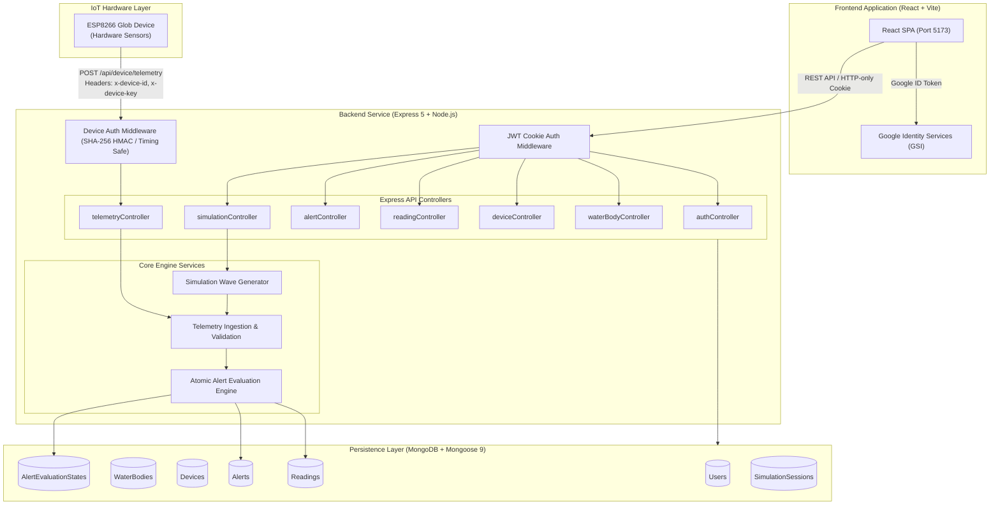
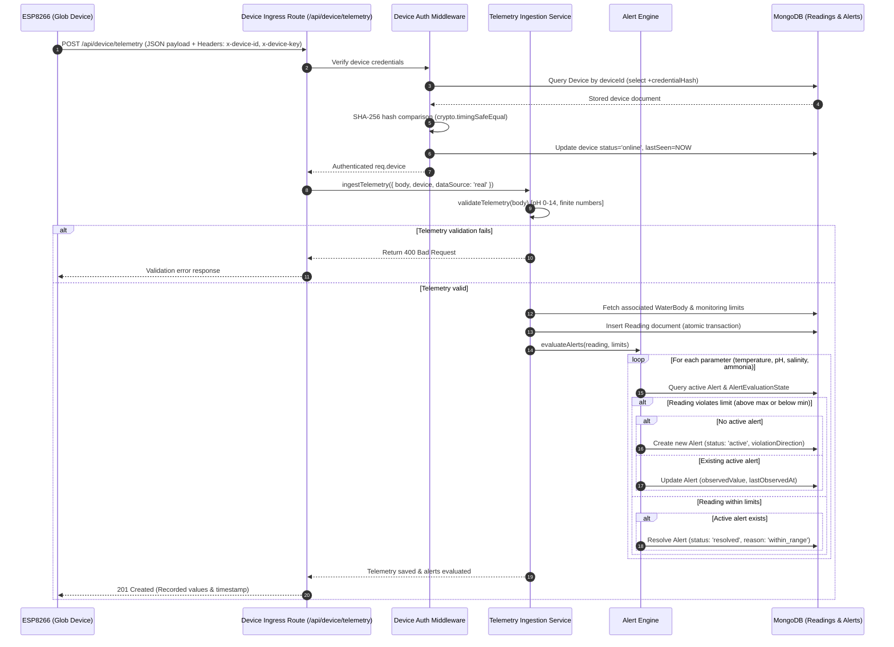
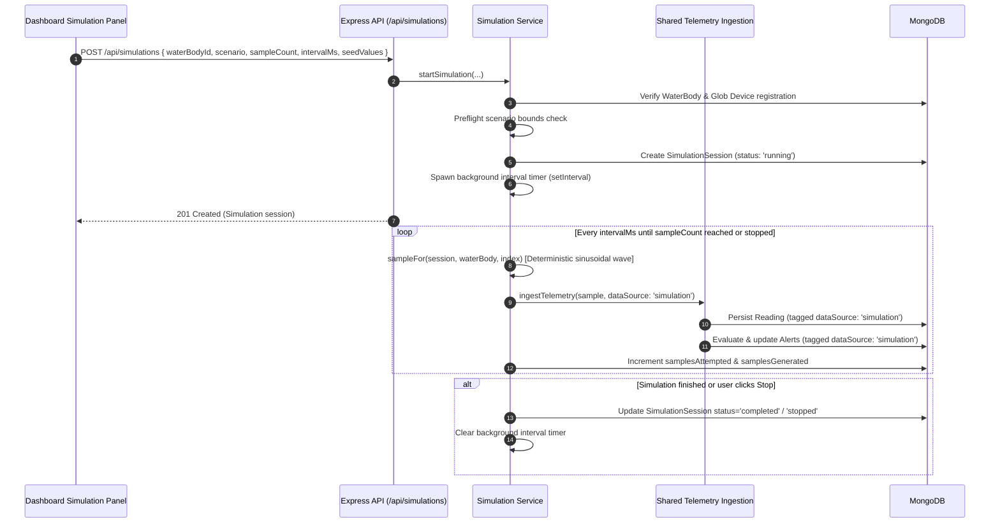

# HydroGen — IoT Water Quality Monitoring Platform

HydroGen is a full-stack, IoT-enabled environmental monitoring platform engineered to collect, evaluate, and visualize real-time water quality metrics for freshwater environments (ponds, lakes, rivers, and fish farms). 

The platform connects to **ESP8266-based Glob hardware devices** via authenticated HTTP telemetry ingress, validates environmental sensor streams, evaluates reading values against user-defined safety boundaries in real time, generates lifecycle-tracked alerts, and provides an interactive analytics dashboard.

---

## Table of Contents

1. [System Architecture](#system-architecture)
2. [Technology Stack & Connections](#technology-stack--connections)
3. [Key Features](#key-features)
4. [Data Flow Diagrams](#data-flow-diagrams)
   - [1. Device Telemetry & Real-Time Alert Pipeline](#1-device-telemetry--real-time-alert-pipeline)
   - [2. User Authentication Flow](#2-user-authentication-flow)
   - [3. Simulation Engine Execution Flow](#3-simulation-engine-execution-flow)
5. [Complete API Reference](#complete-api-reference)
   - [System Health](#system-health)
   - [Authentication Endpoints](#authentication-endpoints)
   - [Water Body Management](#water-body-management)
   - [Device Management & Ingress](#device-management--ingress)
   - [Sensor Readings & History](#sensor-readings--history)
   - [Alerts Engine](#alerts-engine)
   - [Simulation Engine](#simulation-engine)
6. [Data Models & Schema Reference](#data-models--schema-reference)
7. [Monitored Parameters & Sensor Contract](#monitored-parameters--sensor-contract)
8. [Environment Configuration](#environment-configuration)
9. [Installation & Local Setup](#installation--local-setup)
10. [Automated Testing](#automated-testing)

---

## System Architecture



---

## Technology Stack & Connections

### Frontend Client (`/client`)
- **Framework**: React 19 + Vite 8
- **Routing**: React Router v7 (`BrowserRouter`, route protection via `AuthenticatedLayout`, lazy code splitting)
- **Data Visualization**: Recharts v3 (responsive time-series charts, trends, sparklines, dynamic min/avg/max statistics)
- **HTTP Client**: Axios with `withCredentials: true` for secure cookie-based session handling
- **Styling**: Component-scoped CSS design system with responsive layouts and alerts

### Backend Server (`/server`)
- **Runtime**: Node.js (CommonJS modules)
- **Framework**: Express 5.3
- **Database ODM**: Mongoose 9.11 + MongoDB (supporting replica set transactions and standalone fallbacks)
- **Security & Cryptography**:
  - `crypto`: SHA-256 hash generation and timing-safe equality comparison (`crypto.timingSafeEqual`) for IoT devices
  - `google-auth-library`: Server-side verification of Google OAuth 2.0 ID tokens
  - `jsonwebtoken`: Signed JSON Web Tokens stored in HTTP-only, SameSite cookies
  - `cookie-parser`: Secure cookie parsing
  - `cors`: Strict origin validation (`http://localhost:5173`)

### Physical / Hardware Integrations
- **Board**: ESP8266 Wi-Fi Microcontroller module
- **Protocol**: HTTP/1.1 POST over Wi-Fi
- **Security**: Device-specific 32-byte hexadecimal random secret (`x-device-key`), verified against stored SHA-256 hash

---

## Key Features

1. **User Authentication & Multi-Tenancy**
   - Seamless one-click Google Sign-In via Google Identity Services (GIS).
   - Strict session isolation: users can only view and manage water bodies, devices, alerts, and readings registered to their own account.
   - Secure HTTP-only cookie distribution with 7-day expiration.

2. **Water Body Management**
   - Register ponds, lakes, rivers, fish farms, or custom water bodies.
   - Configure independent monitoring limits (minimum and maximum bounds) for temperature, pH, salinity, and ammonia.
   - Optimistic concurrency control and version tracking (`monitoringLimitsVersion`) to sync limits with active alerts.

3. **Device Management ("Glob") & Secure Ingress**
   - 1-to-1 pairing guarantee: each water body can only be assigned to a single Glob device.
   - Device provisioning returns a one-time 64-character secret key.
   - Real-time online/offline calculation based on a rolling 2-minute activity cutoff.
   - Device heartbeat endpoint to maintain connectivity status without logging readings.

4. **Telemetry Ingestion & Strict Validation**
   - Real-time stream processing validating numeric finiteness and valid measurement ranges:
     - Temperature (finite number)
     - pH (strict range: `0.0` to `14.0`)
     - Salinity ($\ge 0$)
     - Ammonia ($\ge 0$ TAN-N)
   - Rejects corrupted or malicious payloads; enforces server-authoritative timestamps (`recordedAt`).

5. **Stateful Real-Time Alert Engine**
   - Atomic evaluation per parameter using concurrency-safe evaluation states (`AlertEvaluationState`).
   - Lifecycle-tracked alerts:
     - **Active**: Created when a reading crosses configured upper or lower bounds.
     - **Updated**: Tracks ongoing out-of-bound observations and timestamps.
     - **Resolved**: Automatically resolves alerts when measurements return to safety limits (`within_range`), when user updates bounds (`limits_changed`), or when monitoring is toggled off (`monitoring_disabled`).
     - **Reopened/Shifted**: Handles sudden direction switches (e.g., from below minimum to above maximum) with `violation_changed`.

6. **Interactive Visual Dashboard & Analytics**
   - Latest reading display cards with trend sparklines and contextual parameter status indicators.
   - Configurable time ranges: 24 Hours, 7 Days, 30 Days, or Custom Date Picker.
   - Data source filter: distinguish between actual Glob device telemetry and simulation data.
   - Automated mathematical summaries: minimum, average, and maximum per range.

7. **Embedded Simulation Engine (Dev & QA Tool)**
   - Generate synthetic readings without physical hardware.
   - Selectable test scenarios: `normal`, `above`, `below`, `recovery`, and `invalid` (for rejection validation).
   - Deterministic wave variation around set baselines.
   - Full lifecycle controls (start, stop, and cascade delete of generated readings and alerts).
   - Environment guard: disabled in production unless `HYDROGEN_ENABLE_SIMULATION=true`.

---

## Data Flow Diagrams

### 1. Device Telemetry & Real-Time Alert Pipeline



### 2. User Authentication Flow

```mermaid
sequenceDiagram
    autonumber
    participant User as Web Browser
    participant Client as React Client (Login.jsx)
    participant GIS as Google Identity Services
    participant API as Express API (/api/auth/google)
    participant G_Auth as Google OAuth API
    participant DB as MongoDB (Users)

    User->>Client: Clicks "Sign in with Google"
    Client->>GIS: Prompt user for Google authentication
    GIS-->>Client: Returns Google credential (ID Token JWT)
    Client->>API: POST /api/auth/google { credential }
    API->>G_Auth: Verify ID Token audience and signature
    G_Auth-->>API: Valid token payload (sub, email, name, picture)
    API->>DB: Upsert User by googleId
    DB-->>API: User record
    API->>API: Generate HydroGen JWT token (expiresIn: 7d)
    API-->>Client: HTTP 200 OK + Set-Cookie: token=<jwt>; HttpOnly; SameSite=Lax
    Client->>Client: Redirect to /water-quality
```

### 3. Simulation Engine Execution Flow



---

## Complete API Reference

Base URL for human/dashboard requests: `http://localhost:5000/api`  
IoT ingress requests: `http://localhost:5000/api/device`

---

### System Health

#### `GET /api/health`
Checks backend availability.
- **Access**: Public
- **Response `200 OK`**:
  ```json
  {
    "success": true,
    "message": "HydroGen backend is running!"
  }
  ```

---

### Authentication Endpoints

Base path: `/api/auth`

#### 1. `POST /api/auth/google`
Authenticates a user using Google OAuth ID Token credential. Sets an HTTP-only session cookie.
- **Access**: Public
- **Request Body**:
  ```json
  {
    "credential": "<Google_ID_Token_JWT>"
  }
  ```
- **Response `200 OK`**:
  ```json
  {
    "success": true,
    "message": "Google login successful",
    "user": {
      "id": "6740b2f...",
      "name": "Alex Mercer",
      "email": "alex@example.com",
      "picture": "https://lh3.googleusercontent.com/..."
    }
  }
  ```
- **Set-Cookie Header**: `token=<jwt_token>; Path=/; HttpOnly; SameSite=Lax; Max-Age=604800`

#### 2. `GET /api/auth/me`
Retrieves profile information for the authenticated user session.
- **Access**: Private (Authenticated cookie required)
- **Response `200 OK`**:
  ```json
  {
    "success": true,
    "user": {
      "_id": "6740b2f...",
      "name": "Alex Mercer",
      "email": "alex@example.com",
      "picture": "https://lh3.googleusercontent.com/..."
    }
  }
  ```

#### 3. `POST /api/auth/logout`
Terminates user session and clears the HTTP-only authentication cookie.
- **Access**: Private
- **Response `200 OK`**:
  ```json
  {
    "success": true,
    "message": "Logged out successfully"
  }
  ```

---

### Water Body Management

Base path: `/api/water-bodies` (All endpoints require authenticated user cookie)

#### 1. `GET /api/water-bodies`
Returns all water bodies created by the logged-in user.
- **Response `200 OK`**:
  ```json
  {
    "success": true,
    "waterBodies": [
      {
        "_id": "674100a...",
        "userId": "6740b2f...",
        "name": "North Reservoir",
        "location": "Sector 4B",
        "waterType": "Lake",
        "monitoringLimits": {
          "temperature": { "enabled": true, "min": 15, "max": 28 },
          "pH": { "enabled": true, "min": 6.5, "max": 8.5 },
          "salinity": { "enabled": false },
          "ammonia": { "enabled": true, "min": 0, "max": 0.05 }
        },
        "monitoringLimitsVersion": 1,
        "createdAt": "2026-11-20T10:00:00.000Z",
        "updatedAt": "2026-11-20T10:00:00.000Z"
      }
    ]
  }
  ```

#### 2. `POST /api/water-bodies`
Registers a new water body for monitoring.
- **Request Body**:
  ```json
  {
    "name": "East Tilapia Pond",
    "location": "Facility Ground 2",
    "waterType": "Fish Farm",
    "monitoringLimits": {
      "temperature": { "enabled": true, "min": 20, "max": 30 },
      "pH": { "enabled": true, "min": 6.5, "max": 8.0 },
      "salinity": { "enabled": true, "min": 0, "max": 5 },
      "ammonia": { "enabled": true, "min": 0, "max": 0.02 }
    }
  }
  ```
- **Validation**:
  - `name`: required string
  - `waterType`: enum `['Pond', 'Lake', 'River', 'Fish Farm', 'Other']`
  - `monitoringLimits`: optional object; if enabled, both `min` and `max` must be finite numbers where `min < max`. pH must fall between 0 and 14.
- **Response `201 Created`**:
  ```json
  {
    "success": true,
    "waterBody": { ... }
  }
  ```

#### 3. `PUT /api/water-bodies/:id`
Updates water body metadata and monitoring thresholds. Increments `monitoringLimitsVersion`.
- **Request Body**:
  ```json
  {
    "name": "East Tilapia Pond - Revised",
    "location": "Facility Ground 2",
    "waterType": "Fish Farm",
    "monitoringLimits": {
      "temperature": { "enabled": true, "min": 22, "max": 32 }
    }
  }
  ```
- **Response `200 OK`**:
  ```json
  {
    "success": true,
    "waterBody": { ... }
  }
  ```

#### 4. `PUT /api/water-bodies/:id/monitoring-limits`
Dedicated endpoint to update only the safety bounds of a water body.
- **Request Body**:
  ```json
  {
    "monitoringLimits": {
      "pH": { "enabled": true, "min": 7.0, "max": 8.2 }
    }
  }
  ```
- **Response `200 OK`**:
  ```json
  {
    "success": true,
    "waterBody": { ... }
  }
  ```

#### 5. `DELETE /api/water-bodies/:id`
Deletes a user's water body.
- **Response `200 OK`**:
  ```json
  {
    "success": true,
    "message": "Water body deleted successfully"
  }
  ```

---

### Device Management & Ingress

#### 1. `POST /api/devices/register`
Pairs an ESP8266 Glob device ID to a water body and generates an authentication secret.
- **Access**: Private (User session)
- **Request Body**:
  ```json
  {
    "deviceId": "GLOB-ESP8266-01",
    "waterBodyId": "674100a..."
  }
  ```
- **Response `201 Created`**:
  ```json
  {
    "success": true,
    "message": "Glob device registered successfully",
    "device": {
      "_id": "674102d...",
      "deviceId": "GLOB-ESP8266-01",
      "waterBodyId": "674100a...",
      "status": "offline",
      "lastSeen": null,
      "createdAt": "2026-11-20T10:15:00.000Z"
    },
    "deviceCredential": "5f4b8e210a4c7e6b91c0e3952a8b341f92e06173a4b95f1c2d3e4f5a6b7c8d9e"
  }
  ```
  *(Note: `deviceCredential` is returned strictly once upon creation. It is never retrievable again).*

#### 2. `GET /api/devices`
Lists all devices owned by the user, dynamically calculating `online` or `offline` status based on whether `lastSeen` was within the last 2 minutes.
- **Access**: Private (User session)
- **Response `200 OK`**:
  ```json
  {
    "success": true,
    "devices": [
      {
        "_id": "674102d...",
        "deviceId": "GLOB-ESP8266-01",
        "waterBodyId": {
          "_id": "674100a...",
          "name": "North Reservoir"
        },
        "status": "online",
        "lastSeen": "2026-11-21T08:00:10.000Z"
      }
    ]
  }
  ```

#### 3. `POST /api/device/heartbeat`
Device check-in ping to mark device online without saving telemetry records.
- **Access**: Device Authentication Required
- **Headers**:
  - `x-device-id`: `GLOB-ESP8266-01`
  - `x-device-key`: `<64_character_device_credential>`
- **Response `200 OK`**:
  ```json
  {
    "success": true,
    "deviceId": "GLOB-ESP8266-01",
    "lastSeen": "2026-11-21T08:00:15.000Z"
  }
  ```

#### 4. `POST /api/device/telemetry`
Primary ingestion endpoint for IoT hardware measurements. Validates stream, stores reading, and executes the alert evaluation pipeline.
- **Access**: Device Authentication Required
- **Headers**:
  - `x-device-id`: `GLOB-ESP8266-01`
  - `x-device-key`: `<64_character_device_credential>`
- **Request Body**:
  ```json
  {
    "temperature": 24.8,
    "pH": 7.42,
    "salinity": 1.25,
    "ammonia": 0.015
  }
  ```
- **Response `201 Created`**:
  ```json
  {
    "success": true,
    "message": "Sensor telemetry saved",
    "deviceId": "GLOB-ESP8266-01",
    "waterBodyId": "674100a...",
    "recordedAt": "2026-11-21T08:00:20.123Z",
    "telemetry": {
      "temperature": 24.8,
      "pH": 7.42,
      "salinity": 1.25,
      "ammonia": 0.015
    }
  }
  ```

---

### Sensor Readings & History

Base path: `/api/readings` (Requires authenticated user cookie)

#### `GET /api/readings`
Fetches paginated historical readings for a specified water body.
- **Query Parameters**:
  | Parameter | Type | Required | Description |
  |---|---|---|---|
  | `waterBodyId` | String (24-hex ObjectId) | **Yes** | ID of the owned water body |
  | `from` | ISO Date String | No | Earliest recorded timestamp |
  | `to` | ISO Date String | No | Latest recorded timestamp |
  | `page` | Positive Integer | No | Page number (default: `1`) |
  | `limit` | Integer (1–100) | No | Items per page (default: `20`) |
  | `dataSource` | Enum (`real`, `simulation`) | No | Filter by stream origin |

- **Response `200 OK`**:
  ```json
  {
    "success": true,
    "readings": [
      {
        "_id": "674108b...",
        "deviceId": "GLOB-ESP8266-01",
        "waterBodyId": "674100a...",
        "temperature": 24.8,
        "pH": 7.42,
        "salinity": 1.25,
        "ammonia": 0.015,
        "recordedAt": "2026-11-21T08:00:20.123Z",
        "dataSource": "real",
        "simulationSessionId": null
      }
    ],
    "page": 1,
    "pageSize": 20,
    "total": 1420,
    "totalPages": 71
  }
  ```

---

### Alerts Engine

Base path: `/api/alerts` (Requires authenticated user cookie)

#### `GET /api/alerts`
Fetches alerts generated when telemetry violates user-configured boundaries.
- **Query Parameters**:
  | Parameter | Type | Allowed Values | Description |
  |---|---|---|---|
  | `waterBodyId` | ObjectId | Valid owned ID | Scope to specific water body |
  | `status` | String | `active`, `resolved` | Filter by alert state |
  | `parameter` | String | `temperature`, `pH`, `salinity`, `ammonia` | Filter by violated sensor |
  | `dataSource` | String | `real`, `simulation` | Filter by reading source |
  | `page` | Integer | $\ge 1$ | Page number (default: `1`) |
  | `limit` | Integer | `1` to `100` | Page limit (default: `20`) |

- **Response `200 OK`**:
  ```json
  {
    "success": true,
    "alerts": [
      {
        "_id": "674109f...",
        "userId": "6740b2f...",
        "waterBodyId": {
          "_id": "674100a...",
          "name": "North Reservoir",
          "location": "Sector 4B"
        },
        "deviceId": "GLOB-ESP8266-01",
        "parameter": "pH",
        "observedValue": 8.92,
        "thresholdSnapshot": {
          "min": 6.5,
          "max": 8.5
        },
        "violationDirection": "above_maximum",
        "status": "active",
        "triggeredAt": "2026-11-21T07:45:00.000Z",
        "lastObservedAt": "2026-11-21T08:00:20.000Z",
        "resolvedAt": null,
        "resolutionReason": null,
        "dataSource": "real",
        "simulationSessionId": null
      }
    ],
    "page": 1,
    "pageSize": 20,
    "total": 1,
    "totalPages": 1
  }
  ```

---

### Simulation Engine

Base path: `/api/simulations` (Requires authenticated user cookie)

#### 1. `GET /api/simulations`
Lists all simulation sessions initiated by the user.
- **Response `200 OK`**:
  ```json
  {
    "success": true,
    "sessions": [
      {
        "_id": "67410aa...",
        "userId": "6740b2f...",
        "waterBodyId": "674100a...",
        "deviceId": "GLOB-ESP8266-01",
        "scenario": "above",
        "status": "running",
        "intervalMs": 5000,
        "sampleCount": 20,
        "samplesGenerated": 6,
        "samplesAttempted": 6,
        "startedAt": "2026-11-21T08:05:00.000Z",
        "stoppedAt": null
      }
    ]
  }
  ```

#### 2. `POST /api/simulations`
Configures and launches an asynchronous simulation session.
- **Request Body**:
  ```json
  {
    "waterBodyId": "674100a...",
    "scenario": "recovery",
    "intervalMs": 3000,
    "sampleCount": 30,
    "seedValues": {
      "temperature": 25,
      "pH": 7.2,
      "salinity": 1.0,
      "ammonia": 0.01
    }
  }
  ```
- **Scenario Options**:
  - `normal`: Fluctuates inside configured safe limits.
  - `above`: Exceeds configured maximum limits.
  - `below`: Drops below configured minimum limits.
  - `recovery`: First half of samples exceed bounds; second half return to safe ranges to demonstrate automatic alert resolution.
  - `invalid`: Transmits invalid telemetry (e.g. pH = 15) to verify pipeline rejection.
- **Response `201 Created`**:
  ```json
  {
    "success": true,
    "session": { ... }
  }
  ```

#### 3. `POST /api/simulations/:id/stop`
Gracefully halts an active simulation run.
- **Response `200 OK`**:
  ```json
  {
    "success": true,
    "session": {
      "_id": "67410aa...",
      "status": "stopped",
      "stoppedAt": "2026-11-21T08:06:12.000Z"
    }
  }
  ```

#### 4. `DELETE /api/simulations/:id`
Stops the session and atomically cascade-deletes all generated readings, alerts, and evaluation states produced by that simulation session.
- **Response `200 OK`**:
  ```json
  {
    "success": true,
    "message": "Simulation and its generated records were deleted"
  }
  ```

---

## Data Models & Schema Reference

### 1. `User` Schema
| Field | Type | Attributes | Description |
|---|---|---|---|
| `googleId` | String | Required, Unique | Google OAuth subject identifier |
| `name` | String | Required | Full display name from Google profile |
| `email` | String | Required, Unique, Lowercase | User email address |
| `picture` | String | Optional | URL to Google profile image |
| `timestamps` | Date | Auto (`createdAt`, `updatedAt`) | Record lifecycle timestamps |

### 2. `WaterBody` Schema
| Field | Type | Attributes | Description |
|---|---|---|---|
| `userId` | ObjectId | Ref: `User`, Required, Index | Owning user ID |
| `name` | String | Required, Trim | Name of the water body |
| `location` | String | Optional | Geographic or facility location |
| `waterType` | String | Enum (`Pond`, `Lake`, `River`, `Fish Farm`, `Other`) | Category of aquatic habitat |
| `monitoringLimits` | Object | Nested schema | User-defined bounds per parameter (`enabled`, `min`, `max`) |
| `monitoringLimitsVersion` | Number | Default: `0`, Incremental | Concurrency version for alert sync |

### 3. `Device` Schema
| Field | Type | Attributes | Description |
|---|---|---|---|
| `deviceId` | String | Required, Unique, Trim | Hardware identifier string |
| `credentialHash` | String | Select: `false` | SHA-256 hash of device secret key |
| `waterBodyId` | ObjectId | Ref: `WaterBody`, Required, Unique | 1-to-1 link to water body |
| `status` | String | Enum (`online`, `offline`) | Reported connectivity status |
| `lastSeen` | Date | Default: `null` | Timestamp of last received request |

### 4. `Reading` Schema
| Field | Type | Attributes | Description |
|---|---|---|---|
| `deviceId` | String | Required, Index | Originating Glob hardware ID |
| `waterBodyId` | ObjectId | Ref: `WaterBody`, Required, Index | Monitored water body |
| `temperature` | Number | Required | Temperature measurement |
| `pH` | Number | Required, Range [0, 14] | Acidity / basicity reading |
| `salinity` | Number | Required, Min: 0 | Salinity reading |
| `ammonia` | Number | Required, Min: 0 | Total Ammonia Nitrogen (TAN-N) |
| `recordedAt` | Date | Default: `Date.now`, Index | Server-assigned timestamp |
| `dataSource` | String | Enum (`real`, `simulation`), Index | Data lineage tag |
| `simulationSessionId`| ObjectId | Ref: `SimulationSession`, Optional | Link to test session if simulated |

### 5. `Alert` Schema
| Field | Type | Attributes | Description |
|---|---|---|---|
| `userId` | ObjectId | Ref: `User`, Required, Index | Target recipient user ID |
| `waterBodyId` | ObjectId | Ref: `WaterBody`, Required | Violated water body ID |
| `deviceId` | String | Required | Transmitting device ID |
| `parameter` | String | Enum (`temperature`, `pH`, `salinity`, `ammonia`) | Violated sensor key |
| `observedValue` | Number | Required | Telemetry reading triggering alert |
| `thresholdSnapshot` | Object | `{ min: Number, max: Number }` | Copy of limit bounds at evaluation |
| `violationDirection`| String | Enum (`below_minimum`, `above_maximum`, `unknown`) | Breach vector |
| `triggeredAt` | Date | Required | Timestamp of initial breach |
| `lastObservedAt` | Date | Required | Timestamp of most recent breach |
| `status` | String | Enum (`active`, `resolved`), Index | Current alert state |
| `resolvedAt` | Date | Default: `null` | Timestamp when normal condition resumed |
| `resolutionReason` | String | Enum (`within_range`, `limits_changed`, etc.) | Why the alert resolved |
| `dataSource` | String | Enum (`real`, `simulation`) | Origin tag |
| `simulationSessionId`| ObjectId | Ref: `SimulationSession`, Optional | Simulation parent ID |

### 6. `AlertEvaluationState` Schema
Coordinates atomic state evaluation and avoids duplicate concurrent alert generation across async threads.
- `userId`, `waterBodyId`, `parameter`, `dataSource`, `simulationSessionId` (Compound Unique Index)
- `lastEvaluatedAt`: Date
- `evaluationVersion`: Number
- `activeAlertId`: ObjectId (Ref: `Alert`)

### 7. `SimulationSession` Schema
Tracks synthetic data generation sessions.
- `userId`, `waterBodyId`, `deviceId`
- `scenario`: Enum (`normal`, `above`, `below`, `recovery`, `invalid`)
- `status`: Enum (`running`, `stopping`, `stopped`, `completed`, `interrupted`, `deleting`)
- `intervalMs`: Number (1000–3,600,000)
- `sampleCount`: Number (1–500)
- `samplesGenerated`: Number
- `samplesAttempted`: Number
- `seedValues`: Mixed Object

---

## Monitored Parameters & Sensor Contract

| Parameter | Key | Expected Unit | Accepted Ingress Range | Scientific Context |
|---|---|---|---|---|
| **Temperature** | `temperature` | °C | $-\infty$ to $+\infty$ (finite number) | Water temperature directly influences chemical reaction rates and dissolved oxygen capacity. |
| **pH** | `pH` | Dimensionless | `0.00` to `14.00` | Indicates acidity or alkalinity. Critical for fish physiology and toxic ammonia speciation. |
| **Salinity** | `salinity` | Sensor Contract Unit | $\ge 0.00$ | Relative salt concentration. High variance impacts osmotic pressure in aquatic life. |
| **Ammonia** | `ammonia` | mg/L (TAN-N) | $\ge 0.00$ | Measures Total Ammonia Nitrogen (TAN). *Note: Un-ionized ammonia ($NH_3$) toxicity depends dynamically on temperature and pH.* |

---

## Environment Configuration

### Backend Server (`server/.env`)
Create a `.env` file inside the `server/` directory:

```env
# MongoDB Connection String (Standalone or Replica Set)
MONGODB_URI=mongodb://127.0.0.1:27017/hydrogen

# Secret key used for signing JWT authentication cookies
JWT_SECRET=replace_with_a_long_random_cryptographic_secret

# Google OAuth 2.0 Client ID (from Google Cloud Console)
GOOGLE_CLIENT_ID=your_google_oauth_client_id.apps.googleusercontent.com

# Environment and Port
NODE_ENV=development
PORT=5000

# Optional: Enable simulation mode in production
HYDROGEN_ENABLE_SIMULATION=false
```

### Frontend Client (`client/.env`)
Create a `.env` file inside the `client/` directory:

```env
# Backend API Base URL
VITE_API_URL=http://localhost:5000/api

# Google OAuth Client ID for Google Identity Services Button
VITE_GOOGLE_CLIENT_ID=your_google_oauth_client_id.apps.googleusercontent.com

# Optional: Enable simulation panel in production build
VITE_ENABLE_SIMULATION=true
```

---

## Installation & Local Setup

### Prerequisites
- [Node.js](https://nodejs.org/) (v18.0.0 or higher recommended)
- [MongoDB](https://www.mongodb.com/try/download/community) installed and running locally on port `27017`
- A Google Cloud Project with OAuth 2.0 Credentials configured for `http://localhost:5173`

---

### Step 1: Clone the Repository
```bash
git clone https://github.com/Krushik03/EVS-el.git
cd EVS-el
```

### Step 2: Install Dependencies

#### Install Server Dependencies
```bash
cd server
npm install
```

#### Install Client Dependencies
```bash
cd ../client
npm install
```

---

### Step 3: Configure Environment Variables
1. Set up `server/.env` based on `server/.env.example`.
2. Set up `client/.env` with your `VITE_GOOGLE_CLIENT_ID`.

---

### Step 4: Run the Application

#### Start the Backend API Server
```bash
cd server
npm run dev
# Server will listen on http://localhost:5000
```

#### Start the React Frontend Development Server
```bash
cd client
npm run dev
# Vite will serve the client on http://localhost:5173
```

Open your browser and navigate to `http://localhost:5173`.

---

## Automated Testing

The backend includes a comprehensive test suite covering device authentication, input validation, alert lifecycle state machines, telemetry ingestion, simulation generators, and retrieval pagination:

```bash
cd server
npm test
```

### Test Coverage Highlights:
- **`deviceAuthentication.test.js`**: Tests SHA-256 timing-safe hash authentication, credential verification, and 2-minute rolling status.
- **`telemetry.test.js`**: Validates strict sensor input domains, boundary checks, and spoof protection.
- **`alertEngine.test.js`**: Verifies alert creation, value updating, `within_range` auto-resolution, and limit alteration handling.
- **`readingRetrieval.test.js`**: Verifies date-range parsing, user isolation, pagination offsets, and max-limit boundaries.
- **`simulation.test.js`**: Tests deterministic sinusoidal variation, multi-scenario sample generation, and cascade cleanup.
